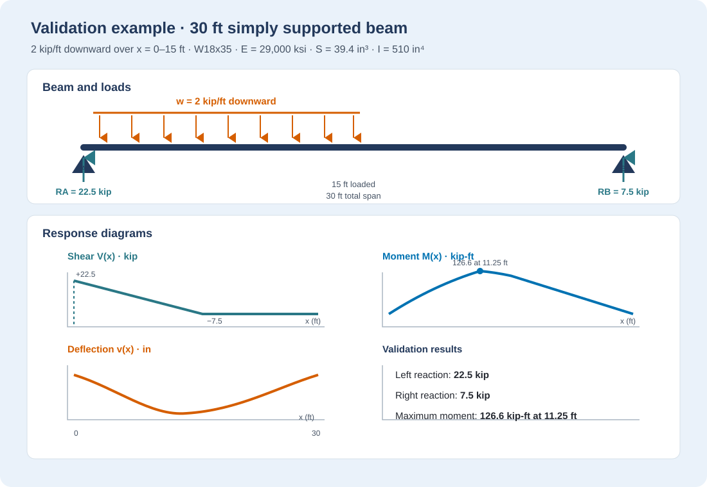

# Beam Designer

Beam Designer is a Python desktop app for analyzing simply supported and cantilever beams. It displays reactions, shear, moment, and deflection diagrams, checks bending and deflection limits, and supports saving designs and exporting CSV results or a PDF calculation sheet. A Cougar Pinball game is also included.

## Equations

Loads are signed positive upward and negative downward. For a simply supported beam of span `L`, the reactions satisfy vertical-force and moment equilibrium:

```text
RA + RB + ΣPi + Σ[qj (bj − aj)] = 0
RB L + Σ(Pi xi) + Σ[qj (bj − aj)(aj + bj)/2] = 0
```

Here `Pi` is a point load at `xi`; `qj` is a uniform load over `[aj, bj]`. For a cantilever, the fixed reactions balance the total applied force and moment. The app forms the response along the beam from equilibrium:

```text
V(x) = RA + applied signed loads to the left of x
M(x) = MA + RA x + moments of applied signed loads to the left of x
EI v''(x) = M(x)
fb,max = |M|max / S
```

The app numerically integrates the moment-curvature relation to obtain deflection, enforcing zero displacement at both ends for a simply supported beam and zero displacement and rotation at the fixed end of a cantilever. Internally, calculations use kip, inches, and ksi; moment is converted to kip-in for deflection and stress calculations. Deflection is checked against the selected limit, defaulting to `L/360`.

## Example: partially loaded simply supported beam

The validation example uses a 30 ft simply supported W18x35 beam with a 2 kip/ft downward uniform load from 0 to 15 ft. The example properties are `E = 29,000 ksi`, `S = 39.4 in³`, and `I = 510 in⁴`. The calculated reactions are 22.5 kip at the left support and 7.5 kip at the right support. Maximum moment is 126.6 kip-ft at 11.25 ft. The illustration shows the response shapes schematically.



## Install

Requires Python with Tkinter, plus NumPy and Matplotlib:

```bash
pip install -r requirements.txt
```

## Start

```bash
python app.py
```
